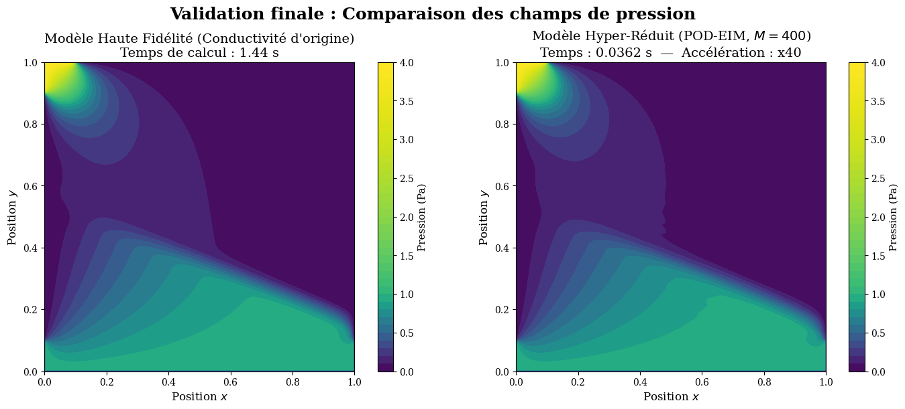
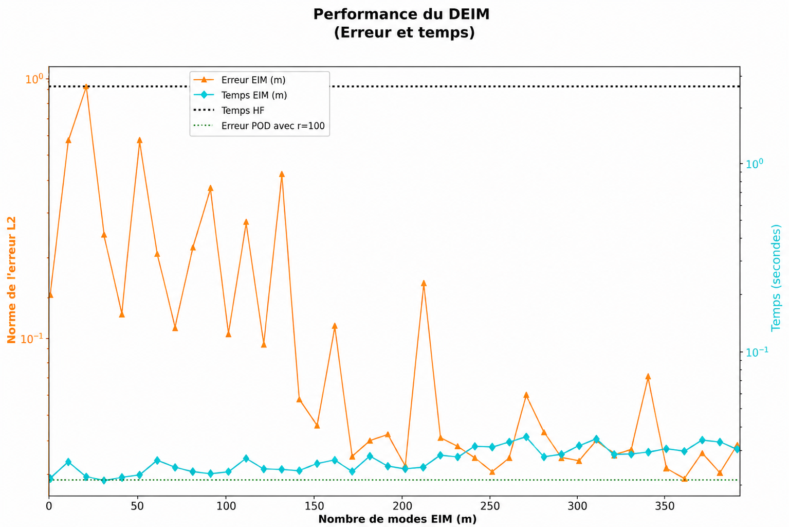

# Réduction de modèle et hyper-réduction pour un écoulement de Darcy en milieu fracturé

Projet de première année, École nationale des ponts et chaussées (2025-2026), encadré par Sofiane Ezzehi (CERMICS).

Ce projet étudie la construction d'un modèle réduit pour un problème de Darcy paramétrique en milieu poreux fracturé. Nous combinons une réduction POD-Galerkin et une hyper-réduction par interpolation empirique (EIM) afin de rendre la phase online indépendante de la taille du maillage. Le modèle obtenu approche la solution éléments finis (160 801 degrés de liberté) avec une erreur L² d'environ 3 %, pour un temps de calcul online environ 80 fois plus faible.



## Problème étudié

On cherche $u \in H^1(\Omega)$ solution de

$$-\nabla \cdot \big(k(x,y;\mu)\, \nabla u\big) = 0 \quad \text{dans } \Omega = [0,1]^2, \qquad u = \bar u \quad \text{sur } \partial\Omega,$$

où les conditions de Dirichlet modélisent un scénario d'injection et de drainage. La conductivité s'écrit

$$k(x,y;\mu) = D_{back} + (D_{frac} - D_{back})\, H\big(D(x,y;\mu)\big),$$

avec $D$ la distance signée à la fracture et $H$ la fonction de Heaviside. Le vecteur de paramètres $\mu = (a, x_0, w, D_{back}, D_{frac})$ décrit la pente, la position et la demi-largeur de la fracture, ainsi que les conductivités du milieu et de la fracture.

Le modèle haute fidélité est discrétisé par éléments finis de Lagrange P2 sur un maillage régulier 200 × 200 (FEniCS). Chaque évaluation demande la résolution d'un système creux de 160 801 inconnues, ce qui devient prohibitif dans un contexte multi-requêtes (optimisation, analyse de sensibilité, simulation en temps réel).

## Démarche

1. **Snapshots.** 200 solutions haute fidélité sont calculées pour des paramètres tirés aléatoirement dans l'espace admissible.
2. **POD-Galerkin.** La SVD de la matrice des snapshots montre une décroissance très rapide des valeurs singulières : $r = 20$ modes capturent plus de 99,9 % de l'énergie, et l'erreur relative passe sous 1 % en norme énergétique. Le problème est ensuite projeté sur cette base par méthode de Galerkin.
3. **Limite de la POD seule.** La dépendance de $k$ aux paramètres géométriques est non affine : la matrice de rigidité doit être réassemblée sur le maillage complet pour chaque nouveau $\mu$. Le coût online reste donc en $O(N_{dof})$, et le gain en temps est faible malgré la réduction de dimension.
4. **Hyper-réduction.** La conductivité est approchée par une décomposition affine $k(x;\mu) \approx \sum_{m=1}^{M} \beta_m(\mu)\, q_m(x)$. Les modes $q_m$ sont obtenus par SVD de 400 snapshots de conductivité, et les coefficients $\beta_m(\mu)$ par interpolation en $M$ points magiques sélectionnés par un algorithme glouton (variante DEIM). Les matrices réduites associées à chaque mode sont pré-assemblées offline, et le coût online devient $O(M r^2)$, indépendant du maillage.
5. **Régularisation.** Appliquée directement, l'interpolation empirique ne converge pas : la discontinuité de $k$ à l'interface de la fracture empêche toute représentation de faible rang. Nous remplaçons la fonction de Heaviside par une sigmoïde de raideur $\alpha = 150$, compromis entre la fidélité à la conductivité originale et la régularité nécessaire à une convergence exponentielle de l'EIM.

## Résultats

- **Cas affine** (géométrie fixe, seules les conductivités varient) : la décomposition est exacte ; la POD séparée atteint la même précision que la POD standard pour un coût online quasi constant.
- **Cas non affine** (géométrie variable) : avec l'EIM régularisée et $r = 100$ modes POD, le temps de calcul online est environ 80 fois plus faible que celui du modèle haute fidélité, pour une erreur L² d'environ 3 %, comparable à celle de la POD seule.
- L'erreur ne décroît pas de façon monotone avec le nombre de points magiques, conséquence du caractère empirique de la méthode.



## Limites et perspectives

- Absence d'étude de convergence en maillage pour justifier le choix du pas $h = 1/200$.
- Absence d'estimateur d'erreur a posteriori permettant de certifier le modèle réduit sans recourir à la solution haute fidélité.
- Extension possible à la dimension 3 et aux problèmes instationnaires (POD-Greedy).

*Erratum : le rapport et les slides indiquent 80 402 degrés de liberté ; la valeur correcte est 160 801 (éléments P2 sur un maillage 200 × 200, soit 401² nœuds).*

## Contenu du dépôt

```
notebooks/   notebook du projet : haute fidélité, POD, cas affine, EIM, régularisation
report/      rapport (PDF et sources LaTeX) et figures
slides/      support de soutenance (PDF)
environment.yml
```

Pour reproduire les résultats :

```bash
conda env create -f environment.yml
conda activate reduced-order-darcy
jupyter lab notebooks/reduction_ordre_darcy.ipynb
```

Le [rapport](report/rapport.pdf) et le [support de soutenance](slides/soutenance.pdf) sont rédigés en français.

## Équipe

Yasmine El Houari, Antonin Aye, Mathis Borie et Marek Piot. Le code a été développé collectivement, en séances de travail communes, avec un suivi hebdomadaire par notre encadrant.